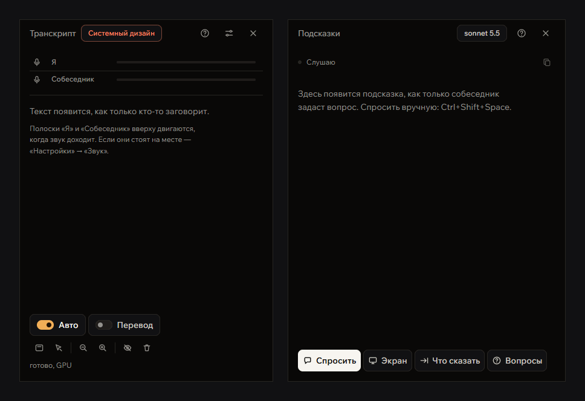
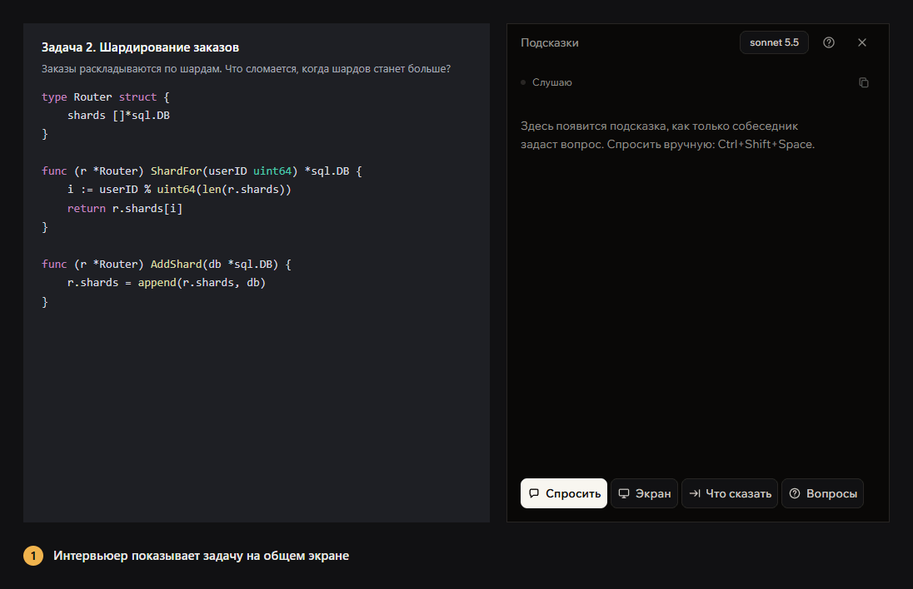
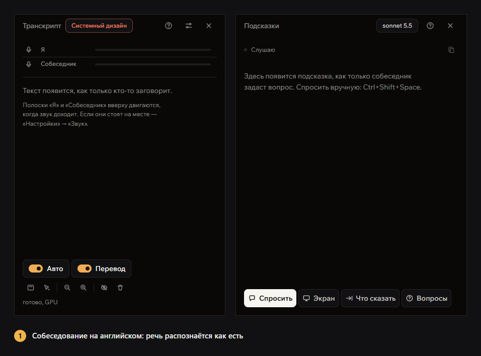

<div align="center">

# Suflyor

**Free, open-source AI interview copilot for Windows. Speech is transcribed on your own PC with Whisper, an answer to the interviewer's question arrives in about a second, and the windows stay invisible to screen sharing.**

[](https://github.com/Crying-Soul/ai-suflyor/releases/latest)

[](LICENSE)


[**Download the installer**](https://github.com/Crying-Soul/ai-suflyor/releases/latest) · [Free, no API key](#free-no-api-key) · [Discussions](https://github.com/Crying-Soul/ai-suflyor/discussions) · [Русский](README.md)



</div>

> [!NOTE]
> The interface is in Russian for now. Interviews in English work: the interviewer's speech is transcribed in English, translated into Russian in the transcript, and hints follow the language of the question. An English UI is planned.

## Features

- **Live transcript.** whisper.cpp transcribes both sides on your GPU, or on the CPU without NVIDIA.
- **Two-tier hints.** A one-line answer first, a full answer right after. Auto-answer can be toggled with a hotkey.
- **Any model.** Claude (API key or a Claude subscription via Claude Code), GPT, Gemini, DeepSeek, Qwen, Kimi, GLM, OpenRouter, local Ollama and LM Studio, any OpenAI-compatible API.
- **Screen + question.** Sends a snapshot of the active window to the model, e.g. a coding task on the shared screen.
- **"What to say" and "My questions".** Ways to continue the conversation and questions to ask the interviewer.
- **Call context.** Your resume, the job description, notes and PDFs up to ~300 pages, plus summaries of earlier calls with the same company.
- **Privacy.** Windows are excluded from screen capture. Everything except the model request runs on your PC.

## How it compares

| | Suflyor | Cluely, Final Round AI, LockedIn AI |
|---|---|---|
| Source code | open, MIT | closed |
| Speech recognition | on your PC | in the vendor's cloud |
| Model | your choice, including local | chosen by the vendor |
| Price | pay per token with your own key, a Claude subscription, or free with a local model | monthly subscription |

<sub>Based on the vendors' public descriptions as of November 2026.</sub>

## Screenshots

**A coding task on a shared screen.** Ctrl+Alt+S sends the active window to the model together with the last question.



**An interview in English.** The question is transcribed in English and translated below it.



## Requirements and cost

| | |
|---|---|
| OS | Windows 10 2004+ or Windows 11, x64 |
| GPU | NVIDIA is optional. With it, text appears in 0.2–0.4 s (RTX 2060 SUPER, large-v3-turbo). Without it, a smaller model runs on the CPU |
| Disk | installer ~125 MB, speech model 0.5–1.6 GB, CUDA acceleration is downloaded separately |
| Language model | a provider API key, a Claude subscription via Claude Code, or a local model in Ollama / LM Studio |
| Cost | the app is free. Answers are billed by the model provider: usually tens of cents per interview hour. A token and cost counter is shown in the transcript window. Local models cost nothing |

## Install

1. Download `Suflyor-Setup-<version>.exe` from the [latest release](https://github.com/Crying-Soul/ai-suflyor/releases/latest) and run it.
2. If Windows shows "Windows protected your PC", click **More info → Run anyway**. SmartScreen does this for apps that are not downloaded often yet. The SHA-256 is on the release page: check it with `Get-FileHash .\Suflyor-Setup-<version>.exe`.
3. The setup window downloads the speech model and, on NVIDIA GPUs, CUDA acceleration.
4. Connect a model: an Anthropic API key, Claude Code with a subscription, or another provider.

Updates install themselves.

### Free, no API key

Install [Ollama](https://ollama.com) and run `ollama pull qwen3:14b`. The model is ~9 GB and wants a GPU with 12 GB or more. On a weaker PC, use `qwen3:4b`. In the setup window, open the third tab and click the Ollama button. Nothing leaves your computer.

## FAQ

<details>
<summary><b>Can Zoom, Teams, Google Meet or OBS see the windows?</b></summary>

No. The windows are excluded from screen capture by Windows itself (Windows 10 2004 and later), so apps that capture the screen do not see them. You can check it on your PC in the privacy settings. This does not hide the windows from a phone camera pointed at the screen or from a capture card.
</details>

<details>
<summary><b>Does it work without an NVIDIA GPU?</b></summary>

Yes. Speech recognition runs on the CPU with a model that keeps up with speech. A local language model without a GPU answers slowly, so use a cloud provider in that case.
</details>

<details>
<summary><b>Where does my data go?</b></summary>

Audio, transcripts, notes and summaries stay on your PC (`Documents\Suflyor` by default). Only the question with the call context and, on a hotkey, a window snapshot go to the model. With Ollama or LM Studio nothing leaves your computer. API keys are encrypted with Windows data protection.
</details>

<details>
<summary><b>Which model should I pick?</b></summary>

Best quality: Claude Sonnet or Opus, GPT-5. Fast hints: Claude Haiku, GPT-4.1 mini, Gemini Flash, deepseek-chat. Reasoning models (deepseek-reasoner, the o-series) answer noticeably later and are worse for a live call.
</details>

## Architecture

- **Rust core** (`core/`): WASAPI capture, Silero VAD, whisper.cpp over FFI, and model clients for the Anthropic Messages API, Claude Code and OpenAI-compatible Chat Completions.
- **Electron UI** (`ui/`): windows, hotkeys and settings.
- The core and the UI talk NDJSON over the core's stdio.

## Build from source

Windows, Rust (stable), Node.js 24. An NVIDIA GPU is optional.

```powershell
powershell -ExecutionPolicy Bypass -File scripts\get-whisper.ps1 -Cuda   # whisper.cpp DLLs and a model in .\whisper
copy config.example.json config.json                                     # key, llm.backend: "api", "claude-code" or "openai"
cargo build --release --manifest-path core\Cargo.toml
cd ui; npm install; npm start
```

Tests: `cargo test --manifest-path core\Cargo.toml`, and in `ui/`: `npm run typecheck` and `npm test`. How to help: [CONTRIBUTING.md](CONTRIBUTING.md).

## License

[MIT](LICENSE).

> [!WARNING]
> Recording calls without the other side's consent may be illegal, and company or platform rules may forbid assistance during an interview. Check the rules in your country and of your employer.
