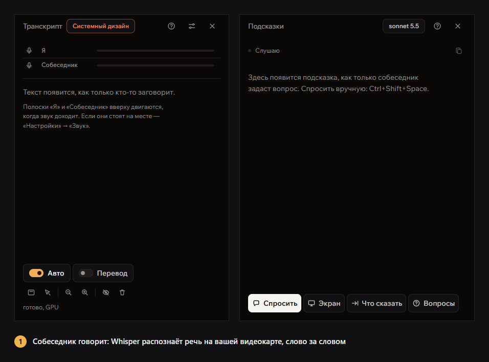
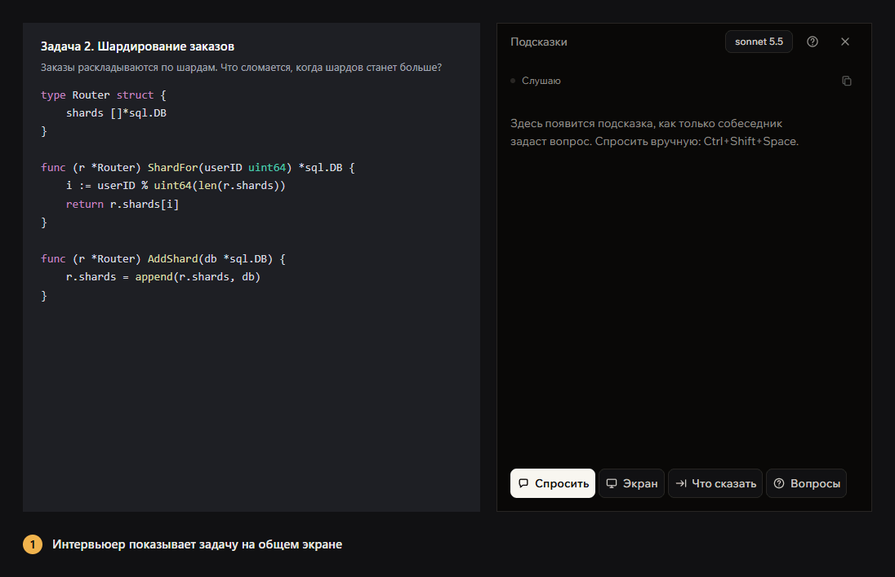
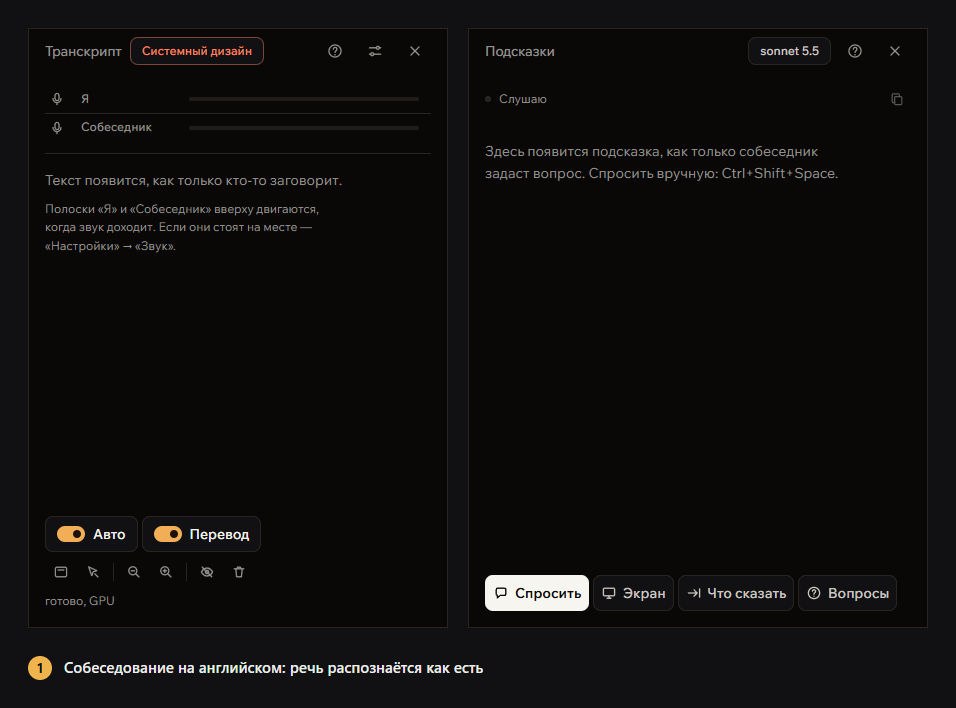
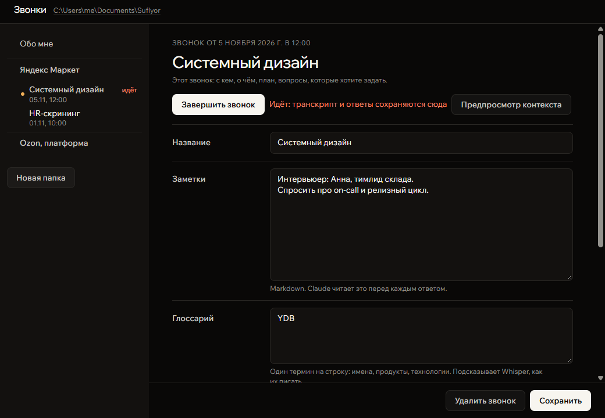
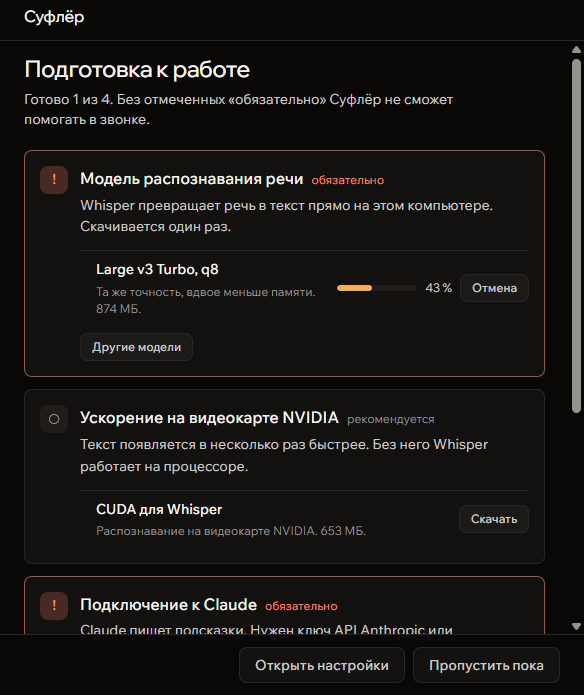
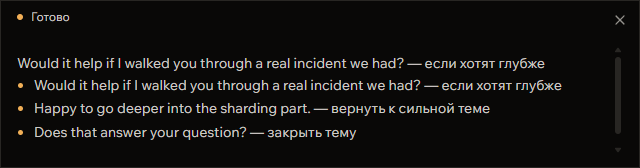

<div align="center">

# Суфлёр

**ИИ-подсказки к собеседованиям и звонкам под Windows: речь распознаётся на вашем компьютере, ответ на вопрос приходит за секунду, а окна не видны в демонстрации экрана.**

*Free, open-source AI interview copilot for Windows: local Whisper transcription, instant answers from Claude, GPT, DeepSeek, Gemini or a local model, invisible to screen sharing.*

[](https://github.com/Crying-Soul/ai-suflyor/releases/latest)

[](LICENSE)


[**Скачать установщик**](https://github.com/Crying-Soul/ai-suflyor/releases/latest) · [Бесплатно, без ключа](#бесплатно-без-ключа) · [Обсуждения](https://github.com/Crying-Soul/ai-suflyor/discussions) · [English](README.en.md)


</div>

## Что умеет

- **Живой транскрипт.** Обе стороны распознаёт whisper.cpp на видеокарте, а без NVIDIA — на процессоре. Реплики одного человека собраны в блоки.
- **Подсказки.** На вопрос собеседника сначала приходит короткий ответ, следом подробный. Режим авто-ответа можно включить хоткеем.
- **Любая модель.** Claude (ключ API или подписка через Claude Code), GPT, Gemini, DeepSeek, Qwen, Kimi, GLM, GigaChat, YandexGPT, OpenRouter, локальные Ollama и LM Studio, любой OpenAI-совместимый API.
- **«Экран + вопрос».** Отправляет модели снимок активного окна, например задачу с кодом на общем экране.
- **«Что сказать» и «Мои вопросы».** Варианты, как продолжить разговор и что спросить самому.
- **Английские собеседования.** Речь собеседника переводится на русский: технические термины остаются по-английски.
- **Контекст звонка.** Резюме, вакансия, заметки и PDF до ~300 страниц. Плюс итоги прошлых звонков с той же компанией.
- **Приватность.** Окна исключены из захвата экрана. Всё, кроме запросов к модели, работает на вашем компьютере.

## Чем отличается

| | Суфлёр | Cluely, Final Round AI, LockedIn AI |
|---|---|---|
| Код | открыт, MIT | закрыт |
| Распознавание речи | на вашем компьютере | в облаке сервиса |
| Модель | любая, на выбор, в том числе локальная | выбирает сервис |
| Оплата | по токенам своего ключа, подписка Claude Code или бесплатно с локальной моделью | ежемесячная подписка |

<sub>По открытым описаниям сервисов на ноябрь 2026.</sub>

## Как это выглядит

### Вопрос и ответ

Речь собеседника распознаётся на вашей видеокарте. Как только прозвучал вопрос, приходит короткий ответ, следом подробный. Ваша реплика тоже попадает в транскрипт.



### Задача на общем экране

Ctrl+Alt+S отправляет модели снимок активного окна вместе с последним вопросом. Подходит для задач с кодом и схем, которые показывает интервьюер.



### Собеседование на английском

Речь собеседника распознаётся по-английски и переводится на русский прямо в транскрипте. Подсказка приходит на русском.



### Подготовка и режимы

<table>
  <tr>
    <td width="50%"></td>
    <td width="50%"></td>
  </tr>
  <tr>
    <td><b>Звонки.</b> Профиль, папки компаний и заметки к каждому звонку. Модель читает их перед ответом.</td>
    <td><b>Подготовка к работе.</b> При первом запуске скачивает модель распознавания и CUDA и подключает языковую модель.</td>
  </tr>
  <tr>
    <td colspan="2"><br><b>«У камеры».</b> Подсказка полоской у объектива, чтобы взгляд не уходил в сторону.</td>
  </tr>
</table>

## Требования и стоимость

| | |
|---|---|
| Система | Windows 10 2004+ или Windows 11, x64 |
| Видеокарта | NVIDIA необязательна. С ней текст появляется за 0,2–0,4 с (RTX 2060 SUPER, large-v3-turbo). Без неё распознаёт модель поменьше на процессоре |
| Диск | установщик ~125 МБ, модель распознавания 0,5–1,6 ГБ, ускорение CUDA скачивается отдельно |
| Языковая модель | ключ API провайдера, подписка Claude через Claude Code или локальная модель в Ollama / LM Studio |
| Стоимость | приложение бесплатно. Ответы оплачиваются у провайдера модели: обычно десятки центов за час собеседования. Счётчик токенов и цены виден в окне транскрипта. Подписка Claude Code и локальная модель доплат не требуют |

## Установка

1. Скачайте `Suflyor-Setup-<версия>.exe` из [последнего релиза](https://github.com/Crying-Soul/ai-suflyor/releases/latest) и запустите.
2. Если Windows покажет «Windows защитила ваш компьютер», нажмите **«Подробнее» → «Выполнить в любом случае»**. Так SmartScreen встречает программы, которые скачивают ещё редко. Контрольная сумма SHA-256 указана на странице релиза, проверка: `Get-FileHash .\Suflyor-Setup-<версия>.exe`.
3. Окно «Подготовка к работе» скачает модель распознавания и, на видеокартах NVIDIA, ускорение CUDA.
4. Подключите модель: ключ API Anthropic, Claude Code с подпиской или другой провайдер (Настройки → Ответы → «Другой провайдер»).

### Бесплатно, без ключа

- **Ollama, локально.** Установите [Ollama](https://ollama.com), затем выполните `ollama pull qwen3:14b`. Модель весит ~9 ГБ, ей нужна видеокарта от 12 ГБ. На слабом компьютере берите `qwen3:4b`. В «Подготовке к работе» откройте вкладку «Бесплатно и другие» и нажмите «Подключить Ollama». Наружу не уходит ничего.
- **GigaChat.** У Сбера есть бесплатный пакет токенов для физлиц. Ключ берётся на [developers.sber.ru](https://developers.sber.ru/studio/), затем Настройки → Ответы → «Другой провайдер» → GigaChat.

Платные модели отвечают точнее: Claude, GPT-5. Но для первого звонка хватит бесплатной.

Обновления приходят сами: «Проверить обновления» в «Справке» или в меню трея.

## Вопросы

<details>
<summary><b>Видят ли окна Суфлёра в Zoom, Teams, Google Meet, Телемосте, OBS?</b></summary>

Окна исключены из захвата экрана средствами Windows (Windows 10 2004 и новее), поэтому программы, которые снимают экран, их не видят. Проверьте на своём компьютере: Настройки → Приватность → «Проверить захват». Камеру телефона, направленную на экран, и карты видеозахвата это не скрывает.
</details>

<details>
<summary><b>Claude недоступен в моей стране. Что выбрать?</b></summary>

GigaChat, YandexGPT, DeepSeek, Qwen, OpenRouter или локальная модель. Настройки → Ответы → «Подключение»: «Другой провайдер», затем провайдер, ключ и модель. Для GigaChat Windows должна доверять сертификату «Russian Trusted Root CA».
</details>

<details>
<summary><b>Работает без видеокарты NVIDIA?</b></summary>

Да. Распознавание идёт на процессоре, окно «Подготовка к работе» предложит модель, которая успевает за речью. Локальная языковая модель без видеокарты будет отвечать медленно: для неё лучше облачный провайдер.
</details>

<details>
<summary><b>Куда уходят мои данные?</b></summary>

Звук, транскрипт, заметки и итоги остаются на компьютере (по умолчанию `Документы\Suflyor`). Модели уходят только вопрос с контекстом звонка и, по клавише, снимок окна. С Ollama или LM Studio наружу не уходит ничего. Ключи API хранятся зашифрованными средствами Windows.
</details>

<details>
<summary><b>Какую модель выбрать?</b></summary>

Лучшее качество: Claude Sonnet или Opus, GPT-5. Быстрая подсказка: Claude Haiku, GPT-4.1 mini, Gemini Flash, deepseek-chat. Модели с долгими рассуждениями (deepseek-reasoner, o-серия) отвечают заметно позже, для живого звонка они хуже.
</details>

<details>
<summary><b>Не нашли ответ?</b></summary>

Спросите в [Обсуждениях](https://github.com/Crying-Soul/ai-suflyor/discussions) или [сообщите об ошибке](https://github.com/Crying-Soul/ai-suflyor/issues/new/choose) с логом (Настройки → Отладка → «Открыть папку логов»).
</details>

## Устройство

- **Ядро на Rust** (`core/`): захват WASAPI, Silero VAD, whisper.cpp через FFI и клиенты моделей: Anthropic Messages API, Claude Code и OpenAI-совместимый Chat Completions.
- **Интерфейс на Electron** (`ui/`): окна, хоткеи и настройки.
- **Связь:** ядро и интерфейс обмениваются NDJSON через stdio ядра.

## Сборка из исходников

Windows, Rust (stable), Node.js 24, видеокарта NVIDIA необязательна.

```powershell
powershell -ExecutionPolicy Bypass -File scripts\get-whisper.ps1 -Cuda   # DLL whisper.cpp и модель в .\whisper
copy config.example.json config.json                                     # llm.backend: "api", "claude-code" или "openai"; ключ: ANTHROPIC_API_KEY или SUFLYOR_LLM_API_KEY
cargo build --release --manifest-path core\Cargo.toml
cd ui; npm install; npm start
```

Тесты: `cargo test --manifest-path core\Cargo.toml`, а в `ui/`: `npm run typecheck` и `npm test`. Их же запускает CI на каждый push (`.github/workflows/ci.yml`). Установщик собирает `npm run dist` в `ui/`. Как помочь проекту: [CONTRIBUTING.md](CONTRIBUTING.md).

## Лицензия

[MIT](LICENSE).

> [!WARNING]
> Записывать звонки без согласия собеседников может быть незаконно, а правила компании или платформы могут запрещать подсказки во время собеседования. Проверьте правила своей страны и работодателя.
