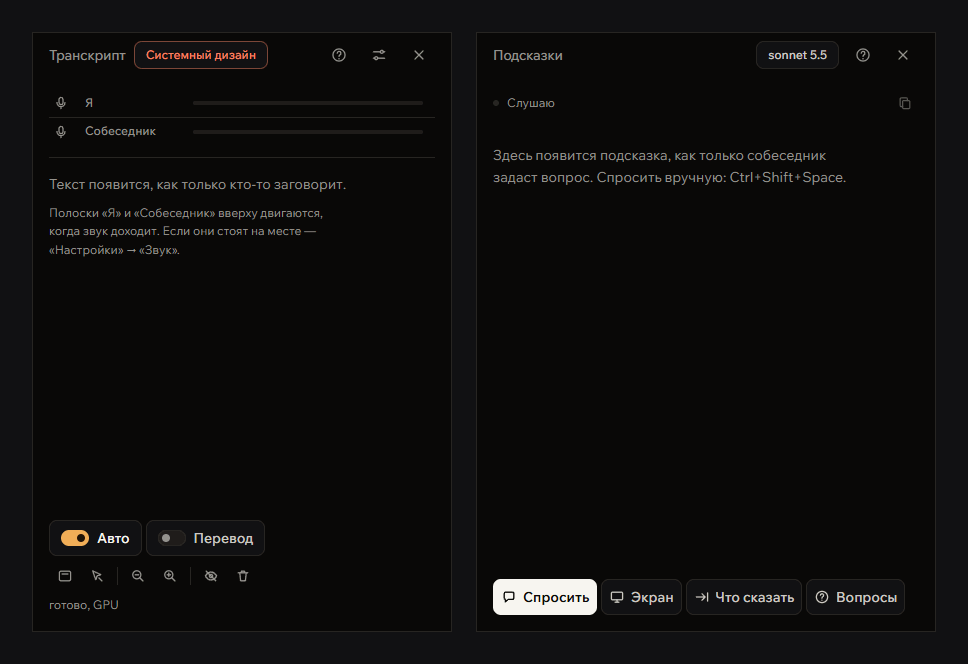
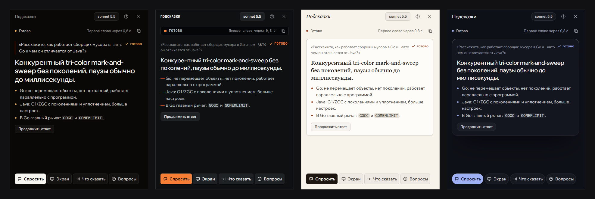
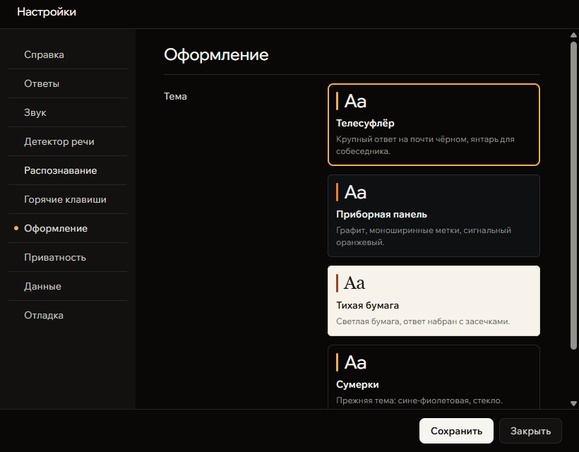

# Суфлёр

**Подсказки к звонкам и собеседованиям под Windows: локальное распознавание речи и ответы Claude в окнах, которых не видно в демонстрации экрана.**

[**Скачать установщик**](https://github.com/Crying-Soul/ai-suflyor/releases/latest)

## Что умеет

- **Живой транскрипт.** Обе стороны распознаёт whisper.cpp на видеокарте, а без NVIDIA — на процессоре. Реплики одного человека собраны в блоки.
- **Подсказки.** На вопрос собеседника сначала приходит короткий ответ, следом подробный. Режим авто-ответа можно включить хоткеем.
- **«Экран + вопрос».** Отправляет в Claude снимок активного окна, например задачу с кодом на общем экране.
- **«Что сказать» и «Мои вопросы».** Варианты, как продолжить разговор и что спросить самому.
- **Английские собеседования.** Речь собеседника переводится на русский через Claude Haiku: технические термины остаются по-английски.
- **Контекст звонка.** Резюме, вакансия, заметки и PDF до ~300 страниц. Плюс итоги прошлых звонков с той же компанией.
- **Приватность.** Окна исключены из захвата экрана. Всё, кроме запросов к Claude, работает на вашем компьютере.

## Темы

Четыре темы, переключаются сразу во всех окнах: Настройки → Оформление.

<table>
  <tr>
    <td width="50%"></td>
    <td width="50%"></td>
  </tr>
  <tr>
    <td><b>Звонки.</b> Профиль, папки компаний и заметки к каждому звонку. Claude читает их перед ответом.</td>
    <td><b>Настройки.</b> Каждая карточка темы нарисована в своих цветах.</td>
  </tr>
  <tr>
    <td></td>
    <td></td>
  </tr>
  <tr>
    <td><b>Подготовка к работе.</b> При первом запуске скачивает модель и CUDA и подключает Claude.</td>
    <td><b>«У камеры».</b> Подсказка полоской у объектива, чтобы взгляд не уходил в сторону.</td>
  </tr>
</table>

## Установка

1. Скачайте `Suflyor-Setup-<версия>.exe` из [последнего релиза](https://github.com/Crying-Soul/ai-suflyor/releases/latest) и запустите.
2. Окно «Подготовка к работе» скачает модель распознавания и, на видеокартах NVIDIA, ускорение CUDA.
3. Подключите Claude: ключ API Anthropic или установленный Claude Code с подпиской.

Обновления приходят сами: «Проверить обновления» в «Справке» или в меню трея.

## Устройство

- **Ядро на Rust** (`core/`): захват WASAPI, Silero VAD, whisper.cpp через FFI и клиент Claude.
- **Интерфейс на Electron** (`ui/`): окна, хоткеи и настройки.
- **Связь:** ядро и интерфейс обмениваются NDJSON через stdio ядра.

> [!WARNING]
> Записывать звонки без согласия собеседников может быть незаконно. Проверьте правила своей страны и платформы.
